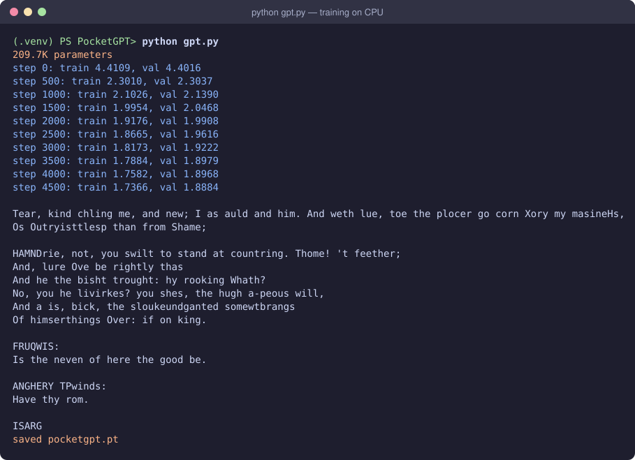
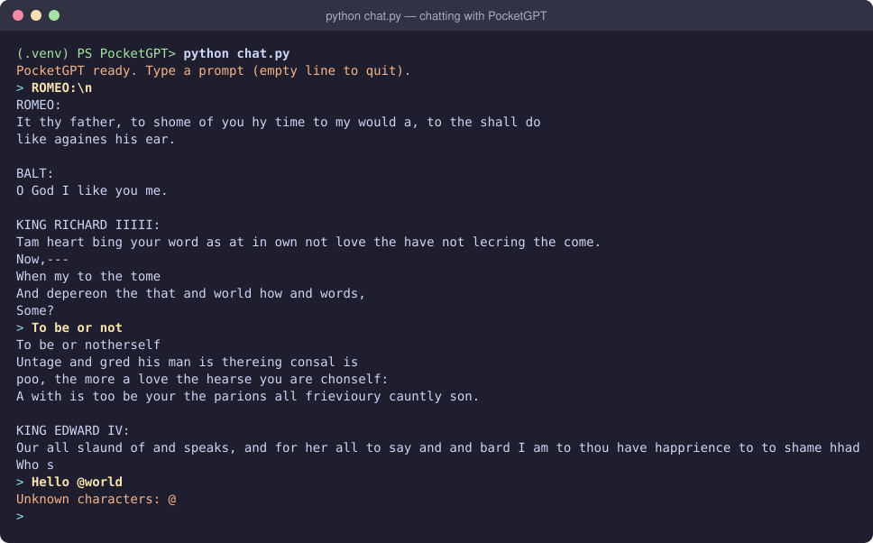
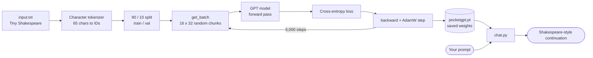
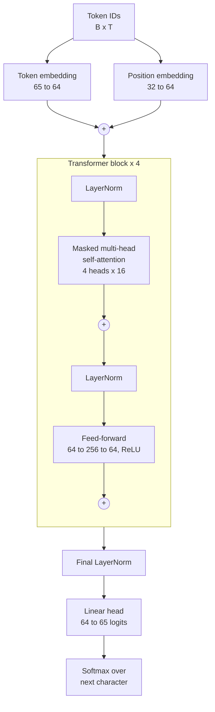
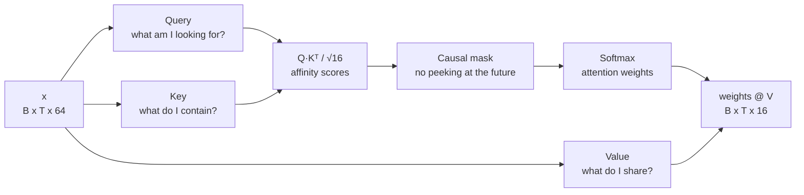
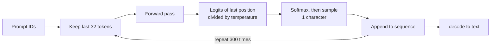

# PocketGPT

A tiny GPT, built from scratch in PyTorch, that learns to write like Shakespeare, one character at a time.


| | |
|---|---|
| **Model** | Decoder-only transformer (GPT-2 style, pre-LayerNorm) |
| **Size** | 209.7K parameters · 4 layers · 4 heads · 64-dim embeddings |
| **Data** | Tiny Shakespeare (~1.1M characters, 65-character vocabulary) |
| **Training** | 5,000 steps on a laptop CPU in about 5½ minutes |
| **Result** | train loss **1.74** · val loss **1.89** (random guessing = 4.17) |

> **Note:** PocketGPT is a *base model*. It continues whatever text you give it in Shakespeare's style; it doesn't answer questions. Turning a base model into an assistant takes an extra fine-tuning stage.

---

## Quick start

```bash
git clone https://github.com/buildwithsoumya/PocketGPT.git
cd PocketGPT
python -m venv .venv
.venv\Scripts\Activate.ps1          # Windows PowerShell  (macOS/Linux: source .venv/bin/activate)
pip install -r requirements.txt
curl.exe -o input.txt https://raw.githubusercontent.com/karpathy/char-rnn/master/data/tinyshakespeare/input.txt
```

```bash
python gpt.py    # train (~5 min on CPU) and save pocketgpt.pt
python chat.py   # load pocketgpt.pt and type prompts
```

A CUDA GPU is used automatically if one is available.

---

## Training

`python gpt.py` trains the model, prints train and validation loss every 500 steps, generates a 500-character sample, and saves the weights to `pocketgpt.pt`.



Loss drops from **4.41** (random) to **1.89** on held-out text. The sample already has the shape of a play: speaker names in capitals, a colon, then lines of verse. The small gap between train and validation loss shows that the model is generalising rather than memorising.

## Chatting

`python chat.py` loads the saved weights and continues whatever you type.



**Tips**
- Type `\n` for a line break: `ROMEO:\n` starts a new speech for Romeo.
- Characters that don't appear in Shakespeare (`@`, most digits, emoji) are rejected with a message instead of crashing.
- Press **Enter** on an empty line to quit.
- Change `temperature` in `chat.py`: `0.5` gives safer, more repetitive text and `1.5` gives wilder text.

---

## How it works

### End-to-end workflow



### Model architecture



Each block has a *residual connection* around attention and around the feed-forward layer (`x = x + layer(norm(x))`): attention lets characters share information with each other, and the feed-forward layer lets each character process what it gathered.

### Inside one attention head



### Text generation loop



---

## Project structure

```
PocketGPT/
├── gpt.py             # tokenizer, data batching, model, training loop, save
├── chat.py            # load saved weights, interactive prompt loop
├── requirements.txt
├── assets/            # README screenshots
├── input.txt          # dataset (downloaded, not committed)
└── pocketgpt.pt       # trained weights (generated, not committed)
```

## Hyperparameters

| Name | Value | Meaning |
|---|---|---|
| `batch_size` | 16 | sequences per training step |
| `block_size` | 32 | max context length, in characters |
| `n_embd` | 64 | size of each token's vector |
| `n_head` | 4 | attention heads per block (16 dims each) |
| `n_layer` | 4 | transformer blocks |
| `dropout` | 0.1 | regularisation during training |
| `learning_rate` | 1e-3 | AdamW step size |
| `max_iters` | 5000 | training steps |

These are sized for a CPU. With a GPU, try `block_size=256, n_embd=384, n_head=6, n_layer=6, dropout=0.2` 

## How it was built

Each phase was developed on its own branch and opened as a stacked pull request:

| Phase | Branch | What was added |
|---|---|---|
| 1 | `phase-1/data` | Character tokenizer, train/val split, batching |
| 2 | `phase-2/bigram` | Bigram baseline, training loop, sampling |
| 3 | `phase-3/attention` | Token + position embeddings, one causal self-attention head |
| 4 | `phase-4/transformer` | Multi-head attention, feed-forward, residual blocks, LayerNorm, dropout |
| 5 | `phase-5/chat` | Saved weights, temperature, interactive `chat.py` |

